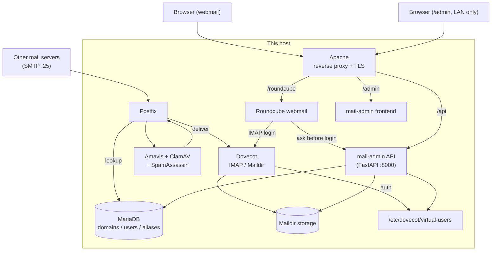

# NannanCat Mail Admin

A self-hosted web admin panel for a Postfix + Dovecot + MariaDB + Roundcube mail
server: mailbox/domain/alias management, IP allow/deny lists with GeoIP lookups,
webmail & admin login history, service control, and one-click system maintenance
(apt upgrades, ClamAV scans, rkhunter checks, Roundcube upgrades).

FastAPI backend, React + Vite frontend, JWT + WebAuthn/passkey admin auth,
zh-TW / en / ja i18n.

📖 **從零開始的完整中文建置指南**（含架構圖、Postfix/Dovecot/MariaDB/Amavis/Roundcube 全部一起架設）：
[`docs/SETUP.zh-TW.md`](docs/SETUP.zh-TW.md)

## Architecture



MariaDB's `domains`/`users`/`aliases` tables are the source of truth — Postfix
queries them live for routing/delivery decisions. Dovecot never talks to the
database directly; it authenticates against a flat `passwd-file`
(`/etc/dovecot/virtual-users`) that mail-admin regenerates from the database on
every mailbox change. Roundcube authenticates straight against Dovecot's IMAP —
mail-admin only touches the login path through the optional `country_gate`
plugin (see the setup guide), and separately reads Roundcube's own log files to
show login history. Full explanation with the reasoning behind each piece:
[`docs/SETUP.zh-TW.md`](docs/SETUP.zh-TW.md#1-原理這些東西怎麼串在一起).

## Is this for you?

This is an operations tool, not a generic app — it manages a real mail server by
shelling out to `systemctl`, `doveadm`, `sudo`-gated maintenance scripts, and a
MariaDB `users`/`domains` schema in the iRedMail style. It's a good fit if you
already run (or are setting up) a Postfix/Dovecot/MariaDB/Roundcube stack and
want a nicer admin UI than raw SQL/CLI. It will not spin up that mail stack for
you.

## Quick start (local dev)

```bash
git clone <this-repo>
cd mail-admin
./install.sh
```

This creates the backend venv, installs Python deps, builds the frontend, and
copies `.env.example` to `.env`. Fill in `.env` (JWT secret, break-glass admin
hash, DB credentials — see comments in the file), then:

```bash
set -a; source .env; set +a
venv/bin/uvicorn api.main:app --reload
# in another shell
cd frontend && npm run dev
```

The dev server proxies `/api` to `http://localhost:8000` (see
`frontend/vite.config.js`).

## Production deployment

1. Copy this repo to the target host (e.g. `/opt/mail-admin`) and run
   `./install.sh` there.
2. Fill in `/etc/mail-admin.env` (or wherever you point `EnvironmentFile`) using
   `.env.example` as the reference — keep it `chmod 600`, owned by the service
   account.
3. Install `deploy/mail-admin.service` to `/etc/systemd/system/`, edit the
   `User=` and paths to match your host, then `systemctl enable --now mail-admin`.
4. Install `deploy/sudoers.d/mail-admin` to `/etc/sudoers.d/mail-admin` — **read
   it first** and replace `SERVICE_USER` with the real account name. It grants
   exactly the commands the API shells out to (dovecot virtual-users rebuild,
   maildir management, IP list sync, service restart/reboot/poweroff, and the
   maintenance scripts below). Validate with `visudo -cf`.
5. Write the four maintenance scripts referenced in
   `api/routers/system_updates.py` for your own OS/package manager and place
   them at:
   - `/usr/local/sbin/mail-admin-apt-upgrade.sh`
   - `/usr/local/sbin/mail-admin-clamav-fullscan.sh`
   - `/usr/local/sbin/mail-admin-rkhunter-check.sh`
   - `/usr/local/sbin/mail-admin-roundcube-upgrade.sh`

   These are host-specific and intentionally not included in this repo.
6. Serve `frontend/dist` (after `npm run build`) under `/admin/` and reverse
   proxy `/api` to `127.0.0.1:8000` — e.g. with Apache `Alias`/`ProxyPass` or an
   Nginx `location` block.

## Optional: Roundcube country gate

`roundcube-plugin/country_gate/` is a small Roundcube plugin that enforces the
country allow/deny list set on the panel's Webmail Policy page, by calling
`/api/webmail-policy/check` before every login. Fail-open by design — see
[`roundcube-plugin/country_gate/README.md`](roundcube-plugin/country_gate/README.md).

## Configuration reference

All configuration is via environment variables — see `.env.example` for the
full list and defaults. Required (no default, the app refuses to start without
them):

| Variable | Purpose |
|---|---|
| `MAIL_ADMIN_USER` / `MAIL_ADMIN_PASS_HASH` | Break-glass super admin, used to bootstrap the first account and as a fallback if `api/data/admins.json` is lost |
| `MAIL_ADMIN_JWT_SECRET` | Signs admin session tokens |
| `MAIL_ADMIN_DB_PASS` | Password for the mail database user |

Everything else (DB host/user/name, WebAuthn RP ID/origin, log/maildata paths,
default mail domain, token TTL) has a generic default and can be overridden —
see `.env.example`.

## Data & privacy

`api/data/` holds runtime state (admin accounts, IP lists, login history,
GeoIP cache, settings) and is gitignored — the app creates these files itself
on first run. Never commit real contents of that directory.

## License

MIT — see [LICENSE](LICENSE).
