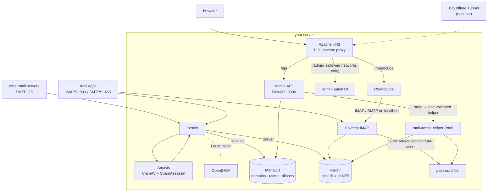

# NannanCat Mail Admin

A self-hosted mail server **with a web admin panel**, installed with one command.

It sets up Postfix, Dovecot, MariaDB, Amavis (ClamAV + SpamAssassin), OpenDKIM and Roundcube webmail on a
fresh Ubuntu server, and gives you an admin panel (FastAPI + React) to run it: mailboxes, domains, aliases,
IP allow/deny lists with GeoIP, webmail and admin login history, service control, one-click system updates,
virus scans and Roundcube upgrades, a security overview, passkey (WebAuthn) logins and a 3-language UI
(English, 繁體中文, 日本語).

[繁體中文說明 → docs/SETUP.zh-TW.md](docs/SETUP.zh-TW.md)

> **Status: 1.1 (beta).** The pieces are validated against the real Postfix 3.10, Dovecot 2.4, Apache 2.4,
> PHP 8.5 and MariaDB 11.8 that Ubuntu 26.04 ships (see [Testing](#testing)), but the installer has not yet been
> run end-to-end on a large number of clean servers. Try it on a fresh VM first and
> [open an issue](https://github.com/jundazhu2007/roundcube-mail-admin/issues) if anything misbehaves.

## Install

On a **fresh Ubuntu 26.04 LTS** server, as root:

```bash
curl -fsSL https://raw.githubusercontent.com/jundazhu2007/roundcube-mail-admin/main/install.sh | sudo bash
```

In a terminal it asks a handful of questions (hostname, certificates, Cloudflare, storage, …) with sensible
defaults and shows a plan before it changes anything. For unattended installs pass everything as flags:

```bash
curl -fsSL https://raw.githubusercontent.com/jundazhu2007/roundcube-mail-admin/main/install.sh | sudo bash -s -- \
  --yes --hostname mail.example.com --email you@example.com --admin-allow 203.0.113.7
```

Prefer to read before you run? Download it first, then run it:

```bash
curl -fsSLO https://raw.githubusercontent.com/jundazhu2007/roundcube-mail-admin/main/install.sh
less install.sh && sudo bash install.sh --help
```

`install.sh` only downloads the release tarball, verifies its SHA-256 against the published `SHA256SUMS`, and
runs the real installer ([`deploy/installer/`](deploy/installer)) from it. `--dry-run` prints every action
without changing anything (and needs no root).

When it finishes you get a summary with the admin URL and password, the first mailbox, and **the exact DNS
records to create** (A, MX, SPF, DKIM, DMARC, PTR).

### What you need

| | |
|---|---|
| OS | Ubuntu **26.04 LTS** or newer (x86-64 or arm64). 24.04 is not supported: it ships Dovecot 2.3, this release configures Dovecot 2.4. |
| Resources | 2 GB RAM (4 GB if you enable antivirus), 10 GB disk plus mail storage |
| Network | a public IP, a DNS name for the server, inbound ports 25 · 465 · 993 · 443 (and 80 for HTTP certificate issuance) |
| Good to know | many ISPs and clouds block outbound port 25 – use `--relayhost` with a smarthost if so |

### Choices you can make

Everything has a default, everything can be set with a flag (`install.sh --help`), a `--config` file, or in the
wizard. The ones people ask about first:

| Question | Options |
|---|---|
| **Cloudflare** (optional, two independent pieces) | **Tunnel**: publish the web UI through `cloudflared` (`--cloudflare-tunnel-token`). **DNS-01 certificates**: get Let's Encrypt certificates through the Cloudflare API, no open port 80 needed (`--tls cloudflare-dns --cloudflare-dns-token`). Mail itself (SMTP/IMAP) can never go through a tunnel – keep the mail host *DNS-only*. |
| **Mail storage** | local disk (default) or an **NFS share / NAS** (`--nfs-server host:/export`): the installer mounts it, writes `/etc/fstab`, and makes Postfix and Dovecot wait for the mount at boot |
| **Certificates** | Let's Encrypt over HTTP · Let's Encrypt over Cloudflare DNS · your own certificate files · self-signed (testing) |
| **Who can open the panel** | `--admin-allow` networks (default: this server's LAN + the IP you run the installer from). Webmail can be public or restricted to the same networks (`--webmail-access`) |
| **Components** | webmail (Roundcube version/plugins/skin/language), antivirus, spam filter, DKIM, fail2ban, firewall (ufw), IPv6 |
| **Attach to an existing server** | `--mode admin-only` installs only the panel and points it at your database |
| **Mail relaying** | `--relayhost [smtp.example.net]:587 --relay-user … --relay-pass …` |

Full reference with examples: **[docs/INSTALL.md](docs/INSTALL.md)**.

### Upgrade, change settings, add a domain

```bash
sudo mail-admin-install --yes --webmail-language ja_JP     # re-run with changed options; secrets and mail are kept
# upgrade just the panel to a newer release (never touches mail, config or data):
curl -fsSL https://raw.githubusercontent.com/jundazhu2007/roundcube-mail-admin/main/install.sh | sudo bash -s -- --upgrade
sudo mail-admin-dkim-add-domain example.org                # DKIM key + the DNS record to publish
```

Domains, mailboxes and aliases are managed in the panel; Roundcube and the OS can be updated from the panel's
**System updates** page.

## How it works



* **MariaDB is the source of truth** for domains, mailboxes and aliases; Postfix queries it live. Dovecot never
  talks to the database – it authenticates against a password file that the panel regenerates from the
  database on every change.
* **Least privilege**: the API runs as an unprivileged account. It may run exactly one root program through
  sudo – `mail-admin-helper` – which validates every argument and input line (mailbox paths cannot escape the
  mail directory, the password file only accepts well-formed entries, …), plus a short list of fixed
  `systemctl` and maintenance-script commands. No blanket `sudo rm/tee/chown`.
* **Admin access is network-restricted** by Apache (`/admin`, `/api`) and protected by bcrypt passwords,
  JWTs, login lockout and optional passkeys.

Details and file locations: [docs/ARCHITECTURE.md](docs/ARCHITECTURE.md).

## Testing

What is automatically checked (run in CI, and runnable locally):

* `bash deploy/installer/tests/render-check.sh` – renders every template for six option combinations and has
  the **real tools** judge the result: `postconf` (Postfix settings and `master.cf`), `doveconf` (Dovecot 2.4),
  `apache2 -t`, `visudo -cf`, `php -l`, `systemd-analyze verify`, and `nft -c` where the runner allows it.
* `bash tests/integration/run.sh` – starts a throwaway MariaDB, runs the installer's real database setup, then
  drives the API (domains, mailboxes, aliases, settings, IP lists, deletion) through the real privileged
  helper and verifies Dovecot password hashes with `doveadm`; also attacks the helper (path traversal,
  symlinks, injected password-file lines, injected Perl) and checks that it refuses.
* `install.sh --dry-run` walks the complete installation and prints each command.

What has **not** been done yet: a full unattended run on a clean machine with real DNS and certificates.

## Development

```bash
./dev-setup.sh         # venv + frontend build + .env (does not touch the system)
```

Backend: FastAPI in [`api/`](api). Frontend: React + Vite in [`frontend/`](frontend). Installer, templates and
maintenance scripts: [`deploy/`](deploy). Configuration is by environment variables – see
[`.env.example`](.env.example). `api/data/` holds runtime state and is never committed.

## License

MIT – see [LICENSE](LICENSE).
