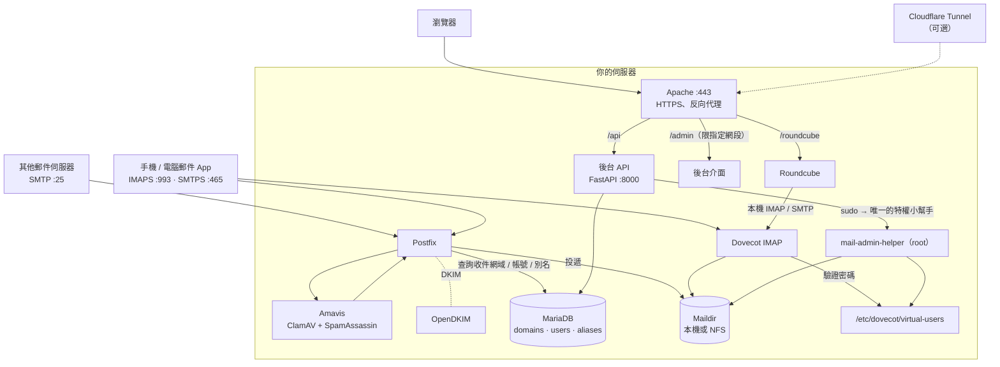

# 繁體中文說明（1.1）

> 英文版是主要文件：[README](../README.md)、[安裝指南 INSTALL.md](INSTALL.md)、[架構 ARCHITECTURE.md](ARCHITECTURE.md)。
> 這份是重點整理與原理說明。

## 這是什麼

一個「自架郵件伺服器 + 管理後台」的一鍵安裝包。在全新的 **Ubuntu 26.04 LTS** 上執行一行指令，會自動裝好並串好：

Postfix（收發信）· Dovecot 2.4（IMAP）· MariaDB（帳號資料庫）· Amavis（ClamAV 防毒 + SpamAssassin 防垃圾信）·
OpenDKIM（簽章）· Roundcube（網頁信箱）· Apache（HTTPS）· 管理後台（FastAPI + React）。

後台功能：信箱 / 網域 / 別名管理、IP 白名單 / 黑名單（含地理位置）、webmail 與後台登入紀錄、服務重啟、
一鍵系統更新 / 病毒掃描 / Roundcube 升級、資安總覽、Passkey 登入、三語介面（繁中 / English / 日本語）。

## 安裝

```bash
curl -fsSL https://raw.githubusercontent.com/Jundahzu/roundcube-mail-admin/main/install.sh | sudo bash
```

在終端機執行會進入問答精靈（每題都有預設值，最後會先列出計畫再問你要不要開始）。想無人值守就用旗標：

```bash
curl -fsSL https://raw.githubusercontent.com/Jundahzu/roundcube-mail-admin/main/install.sh | sudo bash -s -- \
  --yes --hostname mail.example.com --email you@example.com --admin-allow 203.0.113.7
```

- `--dry-run`：只印出每個動作、不改動系統（不需要 root），建議第一次先跑一遍。
- 不想把腳本直接丟進 root shell：先 `curl -fsSLO …/install.sh`，看過再 `sudo bash install.sh`。
- `install.sh` 只負責下載發行包、用 `SHA256SUMS` 驗證，然後執行真正的安裝器 `deploy/installer/`。

### 事前準備

1. 全新的 **Ubuntu 26.04 LTS**（或更新）、有公網 IP。**24.04 不支援**——它的 Dovecot 是 2.3，設定語法和本版使用的 2.4 不同。
2. 一個指向它的網域名稱（例如 `mail.example.com`）。
3. 路由器 / 雲端防火牆開放 **25、465、993、443**（以 HTTP 申請憑證則還要 **80**）。
4. 對外寄信需要出站 25 埠；很多家用網路 / 雲端會封鎖，這時請用 `--relayhost` 走外部 SMTP 轉寄。
5. 向 ISP / 主機商設定反解 PTR（IP → `mail.example.com`），否則很多收信端會退信或當垃圾信。
6. 規格：2 GB RAM（開防毒建議 4 GB）、10 GB 磁碟 + 信件空間。

## 你可以自己選的東西

全部都有預設值，也都可以用旗標、`--config` 檔或精靈設定（完整清單：[INSTALL.md](INSTALL.md#all-options)）。

| 項目 | 選項 |
|---|---|
| **Cloudflare**（可選，兩件事彼此獨立） | **Tunnel**：用 `cloudflared` 把網頁介面（webmail）發佈出去（`--cloudflare-tunnel-token`）。**DNS-01 憑證**：用 Cloudflare API 簽 Let's Encrypt，不需要開 80 埠（`--tls cloudflare-dns --cloudflare-dns-token`）。**郵件本身（SMTP/IMAP）無法走 Tunnel**，郵件主機的 DNS 記錄要設成「僅 DNS（灰雲）」。 |
| **信件儲存** | 本機硬碟（預設），或 **NFS / NAS**（`--nfs-server host:/export`）：自動掛載、寫入 fstab，並讓 Postfix / Dovecot 等到掛載完成才啟動 |
| **憑證** | Let's Encrypt（HTTP）· Let's Encrypt（Cloudflare DNS）· 自己的憑證檔 · 自簽（僅測試） |
| **誰能開後台** | `--admin-allow` 指定網段（預設：伺服器所在區網 + 你執行安裝時的 SSH 來源 IP）；webmail 可公開或同樣限制網段（`--webmail-access internal`） |
| **元件** | Roundcube（版本 / 外掛 / 主題 / 語言）、防毒、防垃圾信、DKIM、fail2ban、防火牆（ufw）、IPv6 |
| **接到既有郵件主機** | `--mode admin-only`：只裝後台，連到你現有的資料庫 |
| **外送中繼** | `--relayhost [smtp.example.net]:587 --relay-user … --relay-pass …` |

## 原理：各部分怎麼串在一起



- **MariaDB 是帳號的唯一真相來源**：網域、信箱、別名都存在這裡，Postfix 即時查詢，新增信箱不用重載。
- **Dovecot 不直接連資料庫**，它用一個純文字密碼檔 `/etc/dovecot/virtual-users`（`帳號:{SHA512-CRYPT}雜湊`）。
  這個檔案由後台在每次新增 / 刪除 / 改密碼時，從資料庫整份重新產生。
- **Roundcube 有自己獨立的資料庫** `roundcube`（只存偏好設定、通訊錄），登入時直接拿使用者的帳密去問 Dovecot。
- **最小權限**：後台 API 不是 root，也沒有一般性的 sudo。它只能透過 sudo 執行一支 `mail-admin-helper`
  （會驗證每個參數與每一行輸入：信箱路徑不能跳出郵件目錄、不能穿過 symlink、密碼檔只接受格式正確的行……），
  以及少數固定的 `systemctl` 與維護腳本。**沒有**萬用的 `sudo rm / tee / chown`。
- **後台限制來源網段**：Apache 用 `Require ip` 限制 `/admin` 與 `/api`，加上 bcrypt 密碼、JWT、登入失敗鎖定、Passkey。

## 安裝完成之後

安裝器最後會印出報告（也存在 `/root/mail-admin-install.txt`，只有 root 能讀）：後台網址與密碼、第一個信箱、
以及**要建立的 DNS 記錄**：

| 類型 | 名稱 | 內容 |
|---|---|---|
| A | `mail.example.com` | 伺服器公網 IP（用 Cloudflare 時設成僅 DNS） |
| MX | `example.com` | `10 mail.example.com.` |
| TXT | `example.com` | `"v=spf1 mx ~all"` |
| TXT | `mail._domainkey.example.com` | 報告中的 DKIM 金鑰 |
| TXT | `_dmarc.example.com` | `"v=DMARC1; p=none; rua=mailto:postmaster@example.com"` |
| PTR | 你的 IP | `mail.example.com`（向 ISP 申請） |

## 日常維運

```bash
sudo mail-admin-install --yes --webmail-language zh_TW   # 改選項後重跑（密碼、信件都會保留）
curl -fsSL https://raw.githubusercontent.com/Jundahzu/roundcube-mail-admin/main/install.sh | sudo bash -s -- --upgrade   # 只升級後台
sudo mail-admin-dkim-add-domain example.org              # 新增網域的 DKIM 並印出 DNS 記錄
```

網域 / 信箱 / 別名在後台管理；Roundcube 與系統套件可在後台的「系統更新」頁一鍵更新。

## 疑難排解

| 狀況 | 做法 |
|---|---|
| 安裝器中途出錯 | 會指出出錯的行；修正後再跑 `sudo mail-admin-install --yes`（可重複執行） |
| 沒有簽到憑證 | 先以自簽憑證完成安裝並提示你；檢查 DNS、80 埠或 Cloudflare token 後重跑 |
| 後台 403 | 你的 IP 不在 `--admin-allow`：`sudo mail-admin-install --yes --admin-allow 你的IP/32,192.168.1.0/24` |
| API 沒起來 | `journalctl -u mail-admin -n 50` |
| 收不到信 / 寄不出去 | `tail -f /var/log/mail.log`、`postqueue -p`；寄不出去多半是出站 25 被封 → `--relayhost` |
| 記憶體不足 | 加 `--no-antivirus`，或加 swap |

## 版本與測試現況

這是 1.1（beta）。各個設定檔已用 Ubuntu 26.04 上的**真實** Postfix 3.10、Dovecot 2.4、Apache 2.4、PHP 8.5、
visudo、systemd 驗證過，API 也已對真實的 MariaDB 11.8 與特權小幫手做過整合測試（見 README 的 Testing）；
但「在全新機器上、使用真實 DNS 與憑證完整跑一次」還需要更多人回報，遇到問題請開 issue。
