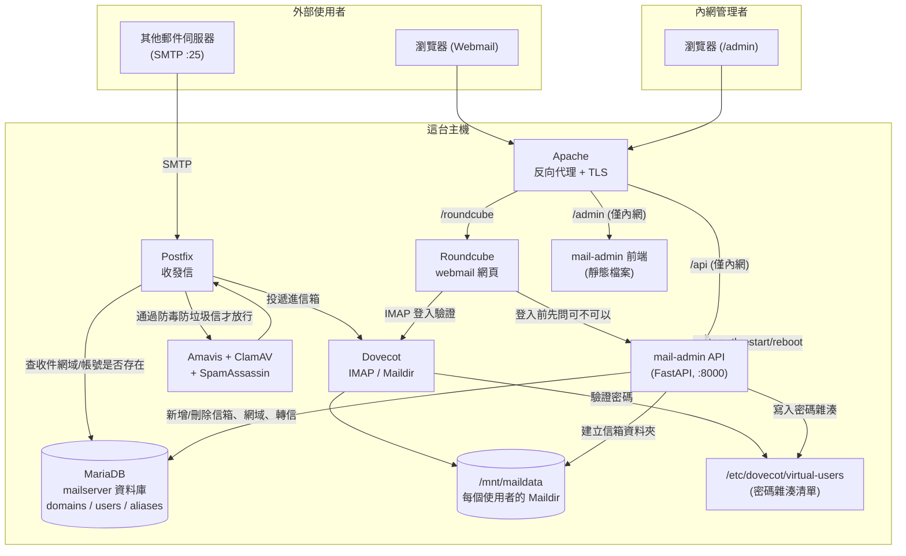

# 從零開始建置指南

這份指南假設你手上是一台全新的伺服器，目標是架出：Postfix（收發信）+ Dovecot（IMAP）+
MariaDB（帳號資料庫）+ Amavis/ClamAV/SpamAssassin（防毒防垃圾信）+ Roundcube（webmail）
+ **mail-admin**（這個 repo：管理後台前後端），全部串在一起。

如果你已經有一套現成的郵件伺服器（Postfix/Dovecot/MariaDB），且資料表結構跟
[第 3 步](#3-安裝-mariadb-並建立帳號資料庫)一致（或你願意調整程式碼裡的 SQL 對齊你的結構），
可以直接跳到 [第 8 步：部署 mail-admin](#8-部署-mail-admin本專案的後端--前端)。

## 目錄

1. [原理：這些東西怎麼串在一起](#1-原理這些東西怎麼串在一起)
2. [系統需求](#2-系統需求)
3. [安裝 MariaDB 並建立帳號資料庫](#3-安裝-mariadb-並建立帳號資料庫)
4. [安裝 Postfix（收發信）](#4-安裝-postfix收發信)
5. [安裝 Dovecot（IMAP）](#5-安裝-dovecotimap)
6. [安裝 Amavis + ClamAV + SpamAssassin（防毒防垃圾信）](#6-安裝-amavis--clamav--spamassassin防毒防垃圾信)
7. [安裝 Roundcube（webmail）](#7-安裝-roundcubewebmail)
8. [部署 mail-admin（本專案的後端 + 前端）](#8-部署-mail-admin本專案的後端--前端)
9. [用 Apache 把三個東西接在同一個網域下](#9-用-apache-把三個東西接在同一個網域下)
10. [開通 webmail 國家門檻（country_gate 外掛）](#10-開通-webmail-國家門檻country_gate-外掛)
11. [第一次登入 & 建第一個信箱](#11-第一次登入--建第一個信箱)

---

## 1. 原理：這些東西怎麼串在一起

先講清楚整體架構，之後每一步在做什麼會比較好理解。



幾個關鍵設計，理解了會少踩很多坑：

- **MariaDB 的 `users`/`domains`/`aliases` 三張表才是真正的帳號來源**。Postfix 靠即時查詢這幾張表決定「這網域收不收」「這帳號存不存在」「這封信要不要轉寄」。
- **Dovecot 不查資料庫**，它用一個純文字檔 `/etc/dovecot/virtual-users`（格式 `email:密碼雜湊`）做密碼驗證。這個檔案由 mail-admin 在每次新增使用者/改密碼時，從資料庫**重新產生整份**（見 [`api/routers/users.py`](../api/routers/users.py) 的 `rebuild_virtual_users()`）。
- **Roundcube 不透過 mail-admin API 登入信箱**——它直接拿使用者輸入的帳密去問 Dovecot 的 IMAP 服務。mail-admin 跟 Roundcube 之間只有兩條很細的線：
  1. `country_gate` 這個 Roundcube 外掛，登入前呼叫 mail-admin 的 `/api/webmail-policy/check` 問「這個 IP 現在准不准登入」（[細節](#10-開通-webmail-國家門檻country_gate-外掛)）。
  2. mail-admin 的「Webmail 登入紀錄」頁面事後讀 Roundcube 自己的 log 檔（`userlogins.log`）跟 Apache access log 來源，兩邊沒有共用資料庫。
- **`/admin` 和 `/api` 應該只開放內網**（見 [第 9 步](#9-用-apache-把三個東西接在同一個網域下)）——這個後台可以重開機、跑 apt upgrade、刪使用者信箱，不該暴露在公網上讓人試密碼。
- mail-admin API 本身**不是** root，靠 `sudo` 白名單（`deploy/sudoers.d/mail-admin`）執行少數幾個固定指令（重建 virtual-users、建 Maildir、重啟服務、重開機……），白名單以外的指令一律拒絕。

---

## 2. 系統需求

本專案實際開發/測試環境如下，其他 Debian 系發行版理論上也可以，但套件名稱/路徑可能要自行對照調整：

| 項目 | 版本 |
|---|---|
|作業系統 | Ubuntu 24.04 LTS 或 26.04 LTS |
| Postfix | 3.10.x |
| Dovecot | 2.4.x（`dovecot-core` + `dovecot-imapd`） |
| MariaDB | 11.8.x |
| Amavis | amavisd-new 2.13.x + ClamAV + SpamAssassin |
| Roundcube | 1.7.x（用官方 tarball 安裝，見[第 7 步](#7-安裝-roundcubewebmail)——發行版的套件版本通常落後好幾個版本） |
| Apache | 2.4.x |
| Python | 3.11+（mail-admin API） |
| Node.js | 20+（build mail-admin 前端用，跑起來之後不需要 Node） |

硬體：小型部署（數十~數百個信箱）2 vCPU / 4GB RAM 堪用，信件儲存空間看信箱數量與 quota 上限抓。

---

## 3. 安裝 MariaDB 並建立帳號資料庫

```bash
sudo apt update
sudo apt install -y mariadb-server
sudo mysql_secure_installation
```

建立 mail-admin 依賴的資料庫與資料表。欄位跟 [`api/routers/users.py`](../api/routers/users.py)、
[`domains.py`](../api/routers/domains.py)、[`aliases.py`](../api/routers/aliases.py) 裡的 SQL 一一對應：

```sql
CREATE DATABASE mailserver CHARACTER SET utf8mb4 COLLATE utf8mb4_unicode_ci;

CREATE TABLE domains (
  id     INT UNSIGNED AUTO_INCREMENT PRIMARY KEY,
  name   VARCHAR(255) NOT NULL UNIQUE,
  active TINYINT(1)   NOT NULL DEFAULT 1
) ENGINE=InnoDB;

CREATE TABLE users (
  id        INT UNSIGNED AUTO_INCREMENT PRIMARY KEY,
  domain_id INT UNSIGNED NOT NULL,
  email     VARCHAR(255) NOT NULL UNIQUE,
  password  VARCHAR(255) NOT NULL,            -- doveadm 產生的 SHA512-CRYPT 雜湊
  quota_mb  INT UNSIGNED NOT NULL DEFAULT 1024,
  active    TINYINT(1)   NOT NULL DEFAULT 1,
  FOREIGN KEY (domain_id) REFERENCES domains(id)
) ENGINE=InnoDB;

CREATE TABLE aliases (
  id          INT UNSIGNED AUTO_INCREMENT PRIMARY KEY,
  domain_id   INT UNSIGNED NOT NULL,
  source      VARCHAR(255) NOT NULL UNIQUE,   -- 別名完整地址
  destination VARCHAR(255) NOT NULL,          -- 轉寄到的真實信箱
  active      TINYINT(1)   NOT NULL DEFAULT 1,
  FOREIGN KEY (domain_id) REFERENCES domains(id)
) ENGINE=InnoDB;

-- mail-admin 跟 Postfix 共用這個帳號；正式環境建議另開一個給 Postfix 用的唯讀帳號
CREATE USER 'mailuser'@'127.0.0.1' IDENTIFIED BY '換成一組夠長的密碼';
GRANT SELECT, INSERT, UPDATE, DELETE ON mailserver.* TO 'mailuser'@'127.0.0.1';
FLUSH PRIVILEGES;
```

這組密碼之後要填進 mail-admin 的 `.env`（`MAIL_ADMIN_DB_PASS`）以及 Postfix 的 MySQL 查詢設定檔。

---

## 4. 安裝 Postfix（收發信）

```bash
sudo apt install -y postfix postfix-mysql
```

安裝過程選 **Internet Site**，Mail name 填你的網域（如 `mail.example.com`）。

建立 vmail 系統帳號（實際信件會落地在這個 uid/gid 底下，跟 mail-admin 的
`MAIL_ADMIN_MAILDATA_PATH` 對齊）：

```bash
sudo groupadd -g 5000 vmail
sudo useradd -g vmail -u 5000 vmail -d /mnt/maildata -m
sudo mkdir -p /mnt/maildata/homes
sudo chown -R vmail:vmail /mnt/maildata
```

三個 MySQL 查詢設定檔（路徑、內容需與資料表結構一致）：

```ini
# /etc/postfix/mysql-virtual-mailbox-domains.cf
user = mailuser
password = 換成第 3 步設定的密碼
hosts = 127.0.0.1
dbname = mailserver
query = SELECT 1 FROM domains WHERE name='%s' AND active=1
```

```ini
# /etc/postfix/mysql-virtual-mailbox-maps.cf
user = mailuser
password = 換成第 3 步設定的密碼
hosts = 127.0.0.1
dbname = mailserver
query = SELECT CONCAT(SUBSTRING_INDEX(email,'@',-1),'/',SUBSTRING_INDEX(email,'@',1),'/Maildir/') FROM users WHERE email='%s' AND active=1
```

```ini
# /etc/postfix/mysql-virtual-alias-maps.cf
user = mailuser
password = 換成第 3 步設定的密碼
hosts = 127.0.0.1
dbname = mailserver
query = SELECT a.destination FROM aliases a JOIN domains d ON a.domain_id=d.id WHERE a.source='%s' AND a.active=1 AND d.active=1
```

```bash
sudo chmod 640 /etc/postfix/mysql-virtual-*.cf
sudo chgrp postfix /etc/postfix/mysql-virtual-*.cf
```

`main.cf` 加上（不要整份覆蓋，用 `postconf -e` 或手動編輯合併進去）：

```bash
sudo postconf -e "virtual_mailbox_domains = mysql:/etc/postfix/mysql-virtual-mailbox-domains.cf"
sudo postconf -e "virtual_mailbox_maps = mysql:/etc/postfix/mysql-virtual-mailbox-maps.cf"
sudo postconf -e "virtual_alias_maps = mysql:/etc/postfix/mysql-virtual-alias-maps.cf"
sudo postconf -e "virtual_mailbox_base = /mnt/maildata/homes"
sudo postconf -e "virtual_uid_maps = static:5000"
sudo postconf -e "virtual_gid_maps = static:5000"
sudo postconf -e "virtual_minimum_uid = 5000"
sudo systemctl restart postfix
```

---

## 5. 安裝 Dovecot（IMAP）

```bash
sudo apt install -y dovecot-core dovecot-imapd dovecot-lmtpd
```

`/etc/dovecot/conf.d/10-mail.conf`：

```
mail_location = maildir:/mnt/maildata/homes/%d/%n/Maildir
```

`/etc/dovecot/conf.d/10-auth.conf`（改用密碼檔驗證，關掉系統帳號驗證）：

```
disable_plaintext_auth = yes
auth_mechanisms = plain login
!include auth-passwdfile.conf.ext
```

`/etc/dovecot/conf.d/auth-passwdfile.conf.ext`：

```
passdb {
  driver = passwd-file
  args = scheme=SHA512-CRYPT username_format=%u /etc/dovecot/virtual-users
}
userdb {
  driver = static
  args = uid=vmail gid=vmail home=/mnt/maildata/homes/%d/%n
}
```

`/etc/dovecot/virtual-users` 這個檔案**不用手動建**——mail-admin 每次新增/刪除使用者、改密碼時會自動重新產生整份（透過 sudo）。先建一個空檔給正確權限即可：

```bash
sudo touch /etc/dovecot/virtual-users
sudo chown root:root /etc/dovecot/virtual-users
sudo chmod 644 /etc/dovecot/virtual-users
sudo systemctl restart dovecot
```

---

## 6. 安裝 Amavis + ClamAV + SpamAssassin（防毒防垃圾信）

```bash
sudo apt install -y amavisd-new clamav-daemon spamassassin
sudo freshclam
```

讓 Postfix 把信先送去給 Amavis 掃過再投遞：

```bash
sudo postconf -e "content_filter = amavis:[127.0.0.1]:10024"
```

`/etc/postfix/master.cf` 加上 Amavis 回注埠：

```
amavis unix - - n - 2 smtp
    -o smtp_data_done_timeout=1200
    -o smtp_send_xforward_command=yes
    -o disable_dns_lookups=yes
    -o max_use=20

127.0.0.1:10025 inet n - n - - smtpd
    -o content_filter=
    -o local_recipient_maps=
    -o relay_recipient_maps=
    -o smtpd_restriction_classes=
    -o smtpd_client_restrictions=
    -o smtpd_helo_restrictions=
    -o smtpd_sender_restrictions=
    -o smtpd_recipient_restrictions=permit_mynetworks,reject
    -o mynetworks=127.0.0.0/8
    -o smtpd_authorized_xforward_hosts=127.0.0.0/8
```

```bash
sudo systemctl restart amavis clamav-daemon spamassassin postfix
```

mail-admin 的 `MAIL_ADMIN_AMAVIS_OVERRIDE_FILE`（預設 `/etc/amavis/conf.d/50-user`）是後台寫入策略覆寫用的檔案，先確保它存在且 Amavis 有讀取到：

```bash
sudo touch /etc/amavis/conf.d/50-user
sudo systemctl restart amavis
```

---

## 7. 安裝 Roundcube（webmail）

發行版套件庫的版本通常落後，這裡用官方 tarball 直接裝（本專案實際用的是 1.7.x 系列）：

```bash
sudo apt install -y php php-cli php-mysql php-mbstring php-intl php-xml php-zip php-curl composer
cd /tmp
curl -LO https://github.com/roundcube/roundcubemail/releases/download/1.7.3/roundcubemail-1.7.3-complete.tar.gz
tar xzf roundcubemail-1.7.3-complete.tar.gz
sudo mv roundcubemail-1.7.3 /var/www/roundcube
sudo chown -R www-data:www-data /var/www/roundcube
```

建一個獨立的 Roundcube 資料庫（**跟 mail-admin 用的 `mailserver` 資料庫是分開的**，Roundcube
只存介面偏好設定、通訊錄，不存信箱帳密）：

```sql
CREATE DATABASE roundcube CHARACTER SET utf8mb4 COLLATE utf8mb4_unicode_ci;
CREATE USER 'roundcube'@'127.0.0.1' IDENTIFIED BY '換成另一組密碼';
GRANT ALL PRIVILEGES ON roundcube.* TO 'roundcube'@'127.0.0.1';
FLUSH PRIVILEGES;
```

到 `https://你的網域/roundcube/installer/` 跑網頁安裝精靈（DB 填上面那組、IMAP host
`ssl://localhost:993`、SMTP host `tls://localhost:587`），跑完後**務必刪掉 installer 目錄**：

```bash
sudo rm -rf /var/www/roundcube/installer
```

`config/config.inc.php` 裡務必把 `des_key` 換成隨機字串（官方範例檔給的是公開的預設值，
不要沿用）：

```bash
openssl rand -base64 32 | head -c 24
```

---

## 8. 部署 mail-admin（本專案的後端 + 前端）

```bash
sudo mkdir -p /opt/mail-admin
sudo chown $USER:$USER /opt/mail-admin
git clone <這個repo的網址> /opt/mail-admin
cd /opt/mail-admin
./install.sh
```

編輯 `.env`（見檔案內註解，包含如何產生 JWT secret、管理員密碼雜湊），然後照
[README.md](../README.md#production-deployment) 的「Production deployment」章節：
安裝 `deploy/mail-admin.service`（systemd）、`deploy/sudoers.d/mail-admin`（**先讀過再套用**，
把裡面的 `SERVICE_USER` 換成實際跑這個服務的系統帳號），並依 `system_updates.py`
用到的四支腳本路徑自己補上（apt upgrade / ClamAV 全機掃描 / rkhunter / Roundcube 升級）。

---

## 9. 用 Apache 把三個東西接在同一個網域下

```bash
sudo apt install -y apache2 certbot python3-certbot-apache
sudo a2enmod proxy proxy_http ssl headers
sudo certbot --apache -d 你的網域
```

`/etc/apache2/sites-available/mail.conf` 參考（**`Require ip` 那兩段換成你自己的內網網段**，
`/admin` 跟 `/api` 不該對公網開放）：

```apache
<VirtualHost *:443>
    ServerName 你的網域

    Alias /roundcube /var/www/roundcube
    <Directory /var/www/roundcube>
        AllowOverride All
        Require all granted
    </Directory>

    # mail-admin 前端 — 僅限內網
    Alias /admin /opt/mail-admin/frontend/dist
    <Directory /opt/mail-admin/frontend/dist>
        AllowOverride All
        Require ip 10.0.0.0/24
        FallbackResource /admin/index.html
    </Directory>

    # mail-admin API — 僅限內網
    <Location /api>
        Require ip 10.0.0.0/24
    </Location>
    ProxyPass /api http://127.0.0.1:8000/api
    ProxyPassReverse /api http://127.0.0.1:8000/api
</VirtualHost>
```

```bash
sudo a2ensite mail
sudo systemctl reload apache2
```

---

## 10. 開通 webmail 國家門檻（country_gate 外掛）

這是選用功能：在 mail-admin 的「Webmail 政策」頁設定國家白名單/黑名單後，要靠一個小的
Roundcube 外掛在登入前去問後端「這個 IP 准不准登入」，外掛原始碼在這個 repo 的
[`roundcube-plugin/country_gate/`](../roundcube-plugin/country_gate/)：

```bash
sudo cp -r roundcube-plugin/country_gate /var/www/roundcube/plugins/country_gate
```

編輯 `/var/www/roundcube/config/config.inc.php`，把 `country_gate` 加進 `$config['plugins']` 陣列。

外掛採**fail-open** 設計：mail-admin API 逾時、掛掉、回傳格式不對，一律當作放行——
不會因為後台掛了就把所有人鎖在 webmail 外面。

---

## 11. 第一次登入 & 建第一個信箱

1. 確認 `mail-admin.service` 正常啟動：`systemctl status mail-admin`
2. 瀏覽器開 `https://你的網域/admin`，用 `.env` 裡 `MAIL_ADMIN_USER` / 對應密碼登入（這是
   「break-glass」帳號，永遠可以用環境變數登入，就算 `api/data/admins.json` 壞掉或被鎖也進得去）
3. 左側選單「網域管理」→ 新增一個網域
4. 「使用者管理」→ 新增一個信箱（會同時寫進資料庫、產生 Maildir、重建 Dovecot 的 virtual-users）
5. 開 `https://你的網域/roundcube`，用剛剛建的信箱帳密登入，確認能收發信
6. 回到後台「管理員」頁，建一個你自己的具名管理員帳號（而不是一直用 break-glass 帳號），
   之後也可以加 Passkey 登入

到這裡整套環境就跑起來了。IP 允許/封鎖清單、webmail 登入紀錄、系統維護（apt/ClamAV/rkhunter/
Roundcube 更新）這些進階功能可以之後再慢慢設定，細節看各自頁面上的說明文字。
